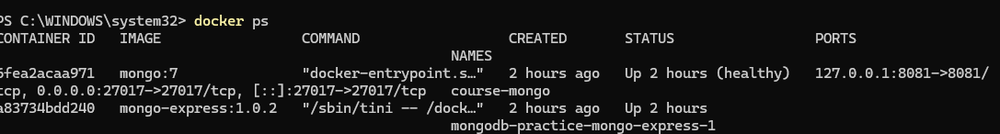
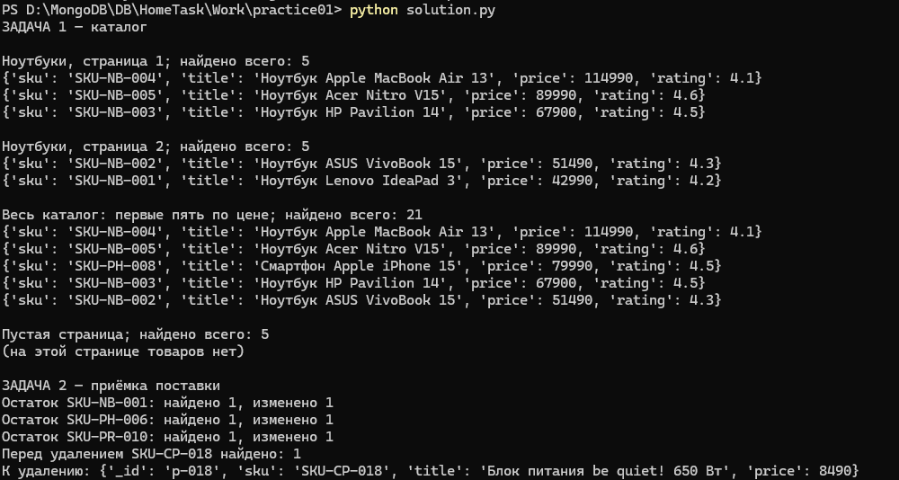
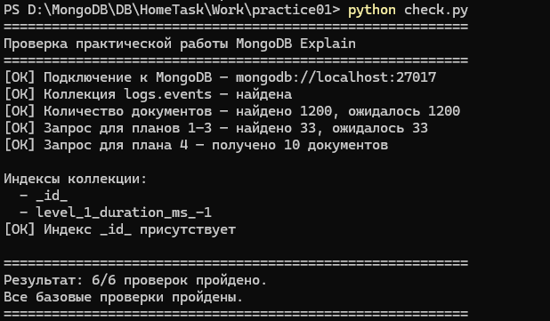

# Практическая работа MongoDB

## 1. Описание работы

В ходе практической работы были выполнены задания по работе с базой данных MongoDB с использованием Python и Docker.

В работе использовались:
- **MongoDB** — база данных.
- **Docker** — запуск контейнеров.
- **Python** и библиотека `pymongo` — взаимодействие с базой данных.
- **MongoDB Compass** — просмотр базы данных и коллекций.

## 2. Запуск контейнеров Docker

Перед выполнением скриптов была проверена работа контейнеров MongoDB и Mongo Express.

Для просмотра запущенных контейнеров использовалась команда:

```powershell
docker ps
```

На скриншоте показаны запущенные контейнеры и состояние MongoDB.



*Рисунок 1 — Проверка запущенных контейнеров Docker.*

## 3. Запуск основного скрипта solution.py

Основной скрипт был запущен из PowerShell командой:

```powershell
python solution.py
```

Скрипт выполняет задания практической работы, связанные с каталогом товаров и обработкой поставки. В результате выводятся найденные товары, результаты обновления остатков, добавления новых позиций и удаления товара.



*Рисунок 2 — Результат выполнения основного скрипта solution.py.*

## 4. Проверка работы базы данных

Для дополнительной проверки был использован скрипт `check.py`:

```powershell
python check.py
```

Скрипт проверяет подключение к MongoDB, наличие коллекции `logs.events`, количество документов, результаты контрольных запросов и наличие индекса `_id_`.

По результатам выполнения были пройдены все 6 базовых проверок.



*Рисунок 3 — Результат выполнения проверочного скрипта check.py.*

## 5. Результаты работы

В ходе выполнения практической работы:

- Проверена работоспособность контейнеров Docker.
- Выполнен основной Python-скрипт `solution.py`.
- Получены результаты запросов к каталогу товаров.
- Выполнены операции обновления, добавления и удаления товаров.
- Проверено подключение к MongoDB и состояние коллекции `logs.events`.
- Успешно пройдены 6 базовых проверок скрипта `check.py`.

## 6. Вывод

В результате практической работы были получены навыки запуска MongoDB в Docker, подключения к базе данных из Python, выполнения запросов и операций изменения документов, а также проверки результатов работы скриптов.


