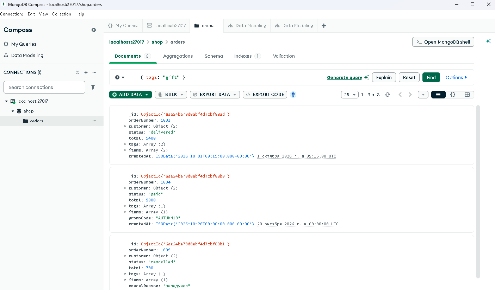

# Занятие 1 · MongoDB: документ, BSON и первая коллекция

ФИО: Бодров Даниил Евгеньевич
Группа: РПО2

Предметная область: заказы интернет-магазина.
База `shop`, коллекция `orders`, 5 документов. Форма у них разная: `tags` есть не везде, у одних есть `promoCode`, у других `cancelReason`.

## Подключение из Compass
1. Запустить сервер MongoDB (у меня через Docker: `docker run -d --name mongo -p 27017:27017 mongo:7`).
2. В Compass New Connection, адрес `mongodb://localhost:27017`, Connect.
3. После подключения слева появляется `localhost:27017`, рядом зелёная точка.

## Загрузка данных
1. Create Database: база `shop`, коллекция `orders`.
2. Открыть `orders`, ADD DATA, Import JSON or CSV file, выбрать `seed.json`.
3. После импорта счётчик показывает `1 – 5 of 5`. Если число другое, очистить коллекцию и загрузить заново.

## Удаление коллекции
В Compass: корзина рядом с `orders`, ввести имя коллекции, Drop Collection.
Или в mongosh: `use shop`, затем `db.orders.drop()`.

## Файлы
- `queries.md` — фильтры, результаты, разбор ошибки
- `seed.json` — данные
- `screenshots/` — скриншот коллекции

## Скриншот

Коллекция `shop.orders` с фильтром `{ tags: "gift" }`, виден счётчик и результат:

